

  

  
  
  
  

# second-brain

**Your notes and your AI chats, in one searchable brain that stays on your computer.**

Ask it a question in plain words and get a short answer with the notes it used. Your Claude Code and Codex chats become notes too, with keys and tokens removed first. Nothing is sent anywhere unless you set up an online writer yourself.

Ready to try it? Jump to the [Quickstart](#quickstart-about-five-minutes).

<h2></h2>

<table>
<tr>
<td width="40%" valign="middle">

<b>One folder. One search. Your computer.</b>

The <b>brain</b> is a plain folder of notes (by default <code>~/brain</code>). A search index reads it, and a small command, <code>brain</code>, asks that index questions.

 <b>Search.</b> <code>brain search</code> finds the best notes. 
 <b>Ask.</b> <code>brain ask</code> answers in one to three sentences and names its sources. 
 <b>Days.</b> What moved today, a morning standup, and reminders. 
 <b>The Deck.</b> A 3D map of your notes in its own window (<a href="deck/README.md">deck/README.md</a>).

</td>
<td width="60%" valign="middle">
</td>
</tr>
</table>

<h2></h2>

  

 <b>Past chats turn into notes you can search.</b> Claude Code and Codex are supported today. Gemini, ChatGPT exports and Cursor are not yet. 
 <b>Secrets go first.</b> Keys, tokens, passwords in links and private key blocks become <code>[redacted]</code> before anything is saved. Redaction cannot be turned off; to skip it, skip the source. Your own email address is dropped once you list it (<code>BRAIN_OWN_EMAILS=you@example.com</code>, or one address per line in <code>~/.config/second-brain/own-emails</code>). 
 <b>You choose what goes in.</b> <code>brain onboard</code> shows what it found and reads nothing until you say. The default is nothing. This is a real run on a made-up folder:

  

<h2></h2>

<table>
<tr>
<td width="46%" valign="middle">

<b>Plain words in. Notes and sources out.</b>

<code>brain search</code> works with keywords as soon as setup is done. <code>brain ask</code> writes a short answer from the notes it found. It needs a model: a small local one through Ollama, or an online writer you set up yourself. It always names its sources.

For meaning-based search (so "restart" finds a note that says "reload"), run <code>qmd embed</code> once. It downloads models. Then set <code>BRAIN_SEMANTIC=1</code>.

</td>
<td width="54%" valign="middle">

| Command | What it does |
|---|---|
| `brain search "words"` | The best five notes, as path and snippet |
| `brain ask "question"` | A short answer with the notes it used |
| `brain onboard` | Choose what goes into the brain, any time |
| `brain status` | Is the search index keeping up? |
| `brain reindex` | Read changed notes now (a timer can do it every hour) |
| `brain day` | What moved today, yesterday or overnight |
| `brain alarm list` | Your reminders |
| `brain drafts` | Draft lessons and test questions waiting for you |

Run `bin/brain` with no words for the full list.

</td>
</tr>
</table>

<h2></h2>

  

| Folder | What |
|---|---|
| `bin/` | The brain command and small wrappers |
| `ask/` | Search and ask: the answer writers, the chat proxy, the memory store |
| `chats/` | Turns Claude Code and Codex chats into notes and removes secrets |
| `index/` | The qmd search config, onboarding, the reindex scripts and optional systemd units |
| `day/` | Day pages, standups and the canvas page |
| `jobs/` | Small jobs: remember, remind, open a note, start a Claude |
| `media/` | Notes for pictures and videos your agents make |
| `eval/` | A weekly check-up that scores the search on questions you give it |
| `deciders/` | The privacy list guard (decider tools are optional and not part of this repo) |
| `deck/` | The Deck: a 3D map of your notes |

<h2></h2>

  

 <b>It lives on your computer.</b> The brain is a plain folder. It never lives inside a repository and is never pushed. 
 <b>Chats are redacted before they become notes.</b> 
 <b>The private list.</b> Put words in <code>deciders/private.json</code> (copy <code>private.example.json</code>) and any ask that contains them is kept away from online models. An empty or broken list stops anything being sent. 
 <b>Folders you choose stay where they are.</b> The search reads them in place and never changes them.

## Quickstart (about five minutes)

You need Python 3.12 or newer, git and the Python package `pyyaml`, plus qmd, the local notes search (`npm i -g @tobilu/qmd`, needs Node 22.12 or newer). Optional: Ollama with a small model for `brain ask`; numpy and Node for the Deck; Claude Code if you want your chats turned into notes.

An AI agent can follow these steps from a fresh clone. Each step says what you should see.

1. **Get the code:** `git clone https://github.com/DogmaLabsTech/second-brain.git`, then go into the folder.
2. **Check the computer:** run `./install.sh`. You should see "ok" for each needed tool and a line that says Ready. Fix anything marked MISSING and run it again. (`./install.sh --json` gives the same answer for scripts.)
3. **Choose what goes in:** run `bin/brain onboard`. It lists the notes folders and AI chat histories it found and asks about each one. Say no to anything you do not want. Or, without questions: `bin/brain onboard --yes --notes ~/notes --sessions claude`
4. **Try it:** run `bin/brain search "something from your notes"`. You should see paths and snippets.
5. **Optional:** put `bin/brain` on your PATH, for example `ln -s "$PWD/bin/brain" ~/.local/bin/brain`

More detail and a checklist for a brand-new machine: [docs/getting-started.md](docs/getting-started.md).

## Optional extras

- **Run things on a timer:** `index/install-units.sh` copies the systemd user units into place with your real path filled in. It enables nothing. Turn on only the timers you want.
- **The Deck:** see [deck/README.md](deck/README.md).
- **Local models:** install Ollama and pull a small model, for example `ollama pull qwen2.5:3b`. Set `BRAIN_LOCAL_MODEL` to use another.

## Tests

Run `bin/test`. It runs every folder in a throwaway home, so it never touches your real notes. Tests that need your own data or services skip themselves.

## Using it with agent-os

[agent-os](https://github.com/DogmaLabsTech/agent-os) is the desk that talks to your AI team. Its `agent-os start` step finds this brain, shows what it could read and ingests only what you choose. The brain works on its own too; agent-os is optional.

## Licence

The code is MIT licensed ([LICENSE](LICENSE)). The pictures in `docs/media/readme/` are CC BY 4.0 ([LICENSE-ART](LICENSE-ART)); `make_art.py` there draws them. Third-party notices are in [NOTICE](NOTICE).
